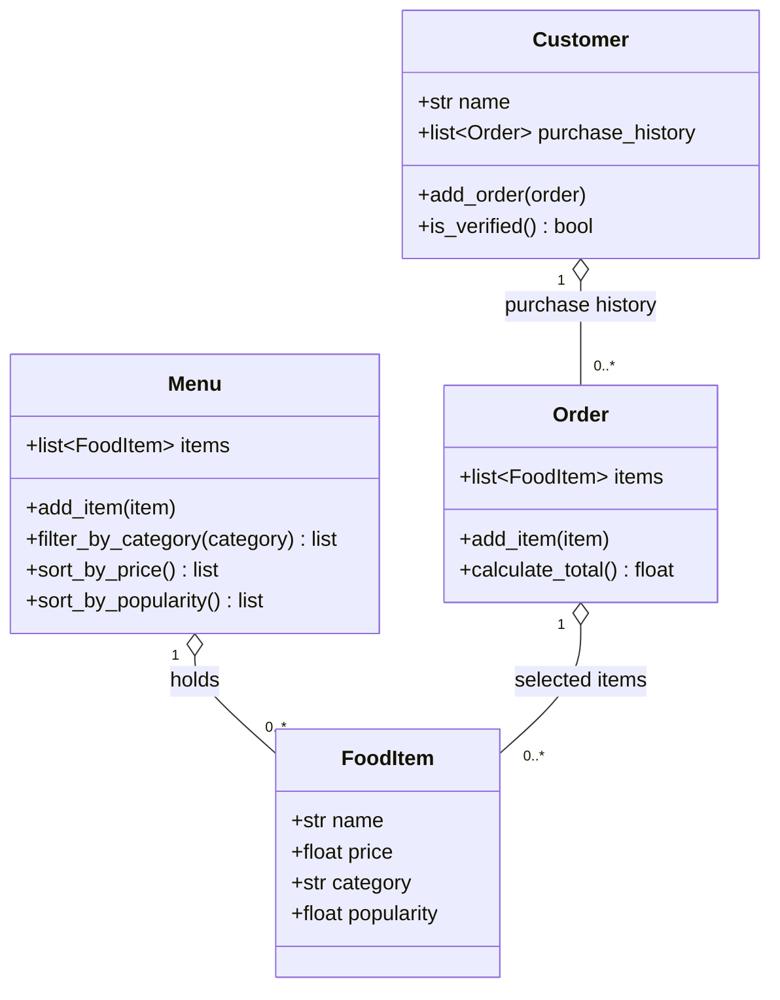

# ByteBites Final Design

This diagram was produced in a new chat with ByteBites_Design_Reference.md attached, then refined until every class, attribute, and method traced back to the feature request.

## What each class represents

- Customer: a user with a name and a history of past orders. A customer counts as verified once they have at least one past order.
- FoodItem: one item for sale with a name, price, category, and popularity rating.
- Menu: the full list of food items, with filtering by category and sorting.
- Order: one transaction that holds the selected items and computes their total cost.

## How this differs from the first draft

| First draft without the reference | Final design with the reference |
|-----------------------------------|---------------------------------|
| Seven classes including User, Cart, and Payment | Only the four classes in the spec |
| Customer inherited from User with login and passwords | No inheritance, only composition |
| Extra fields like loyalty points, allergens, coupons | Only the fields the request names |
| No link from Customer to past orders | Customer keeps a list of past Orders to verify real users |
| Order not linked to FoodItem | Order holds the FoodItems it contains |

The reference file worked because it wrote the scope rules down once: only four classes, only fields the spec names, composition instead of inheritance, and which class owns each behavior. Without it the assistant filled gaps with features it guessed a food app might want.
