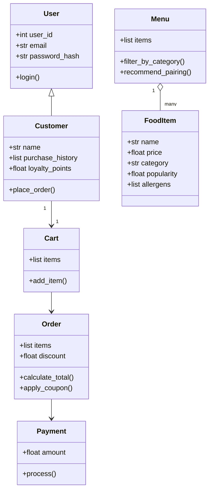

# Draft UML, first pass without the reference file

Prompt used, with only bytebites_spec.md attached:

```
Here is the ByteBites feature request. I think the system needs four classes:
Customer, FoodItem, Menu, and Order. Draw a UML style class diagram with their
attributes, methods, and relationships.
```

Draft the assistant returned:



## Review of this draft

- It added four things the spec never asked for: a User parent class with login and passwords, a Cart, a Payment class, and a pairing recommender.
- It added attributes that do not appear in the request: loyalty points, allergens, discounts, and coupons.
- It used inheritance from User, which the spec does not need.
- It is missing the Customer to Order history link that the spec uses to verify real users, and Order is not linked to FoodItem.
- The parts it got right were the four core attributes on FoodItem, a list of items on Menu, and filter_by_category on Menu.

I kept this draft only for comparison and wrote the final design in bytebites_design.md.
